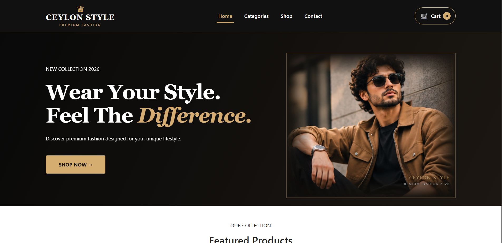
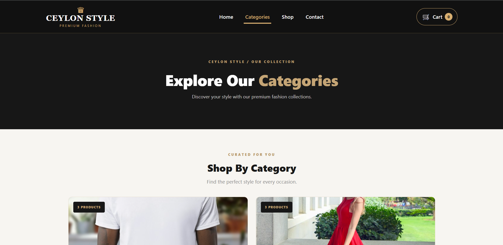
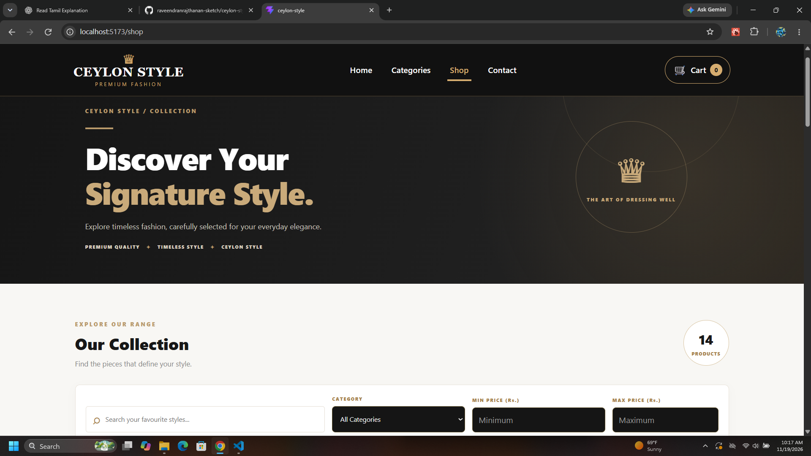
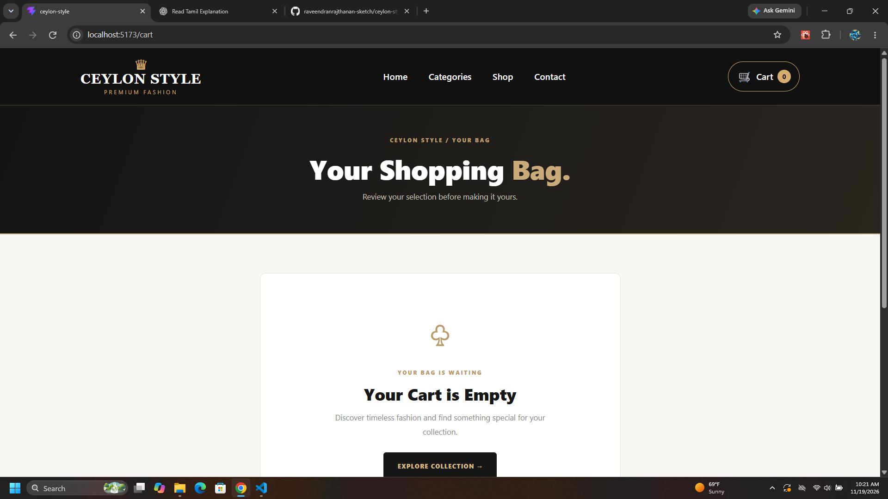
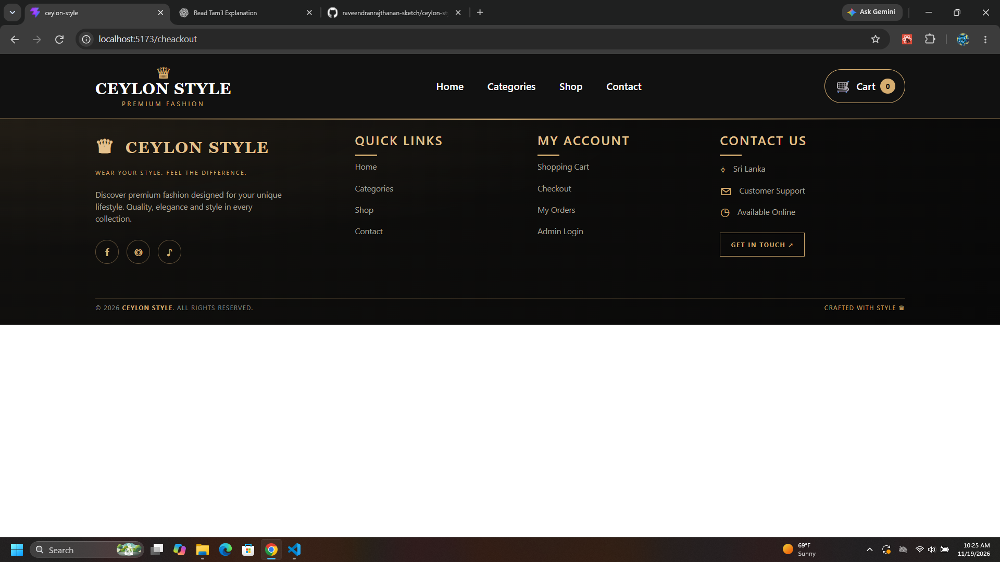
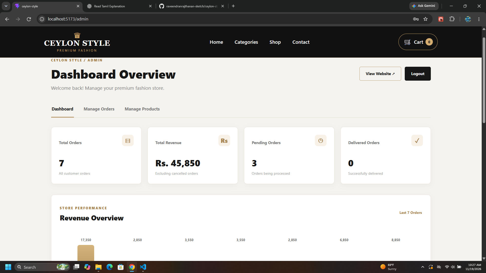
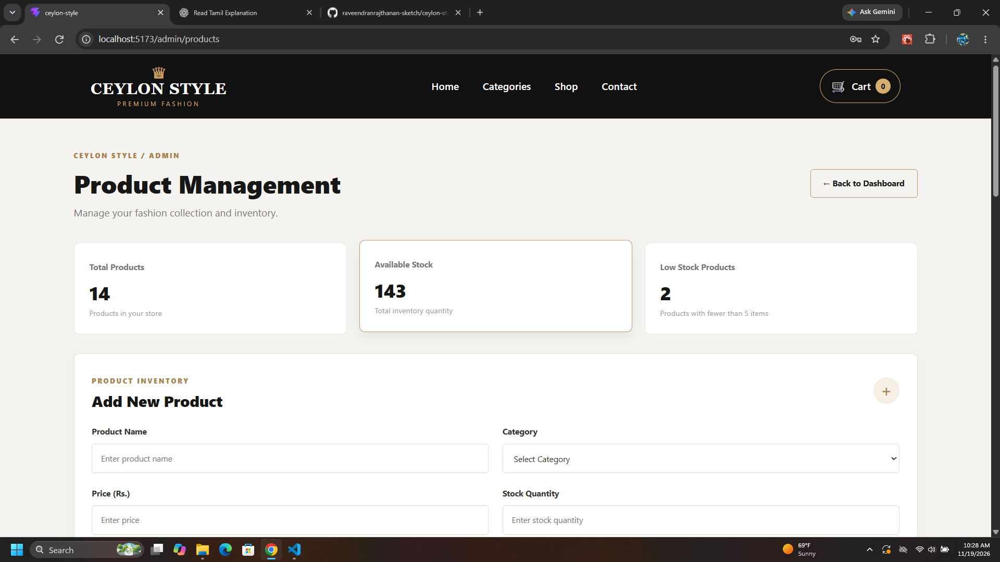
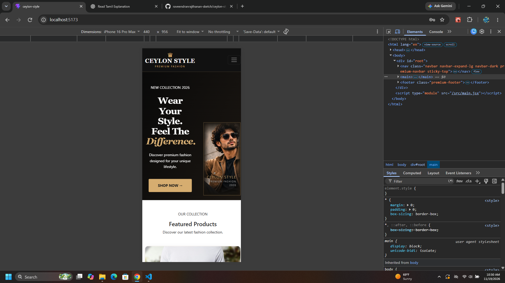

# 👑 Ceylon Style – Premium Fashion E-Commerce Website

A modern, responsive, multi-page fashion e-commerce website built using **React, Vite, JavaScript, Bootstrap and CSS3**.

Ceylon Style delivers a premium online shopping experience through an elegant black-and-gold design, product collections, shopping cart, checkout system and order management.

## 🌐 Live Demo

Coming Soon

## 📌 Project Overview

Ceylon Style is a fashion e-commerce web application designed to provide customers with a simple, convenient and user-friendly online shopping experience.

Customers can explore fashion products, browse categories, search and filter collections, manage their shopping cart, complete checkout and view their order history.

The application also includes an administrative interface for product and order management.

## ✨ Main Features

### Customer Features
- Premium homepage with featured products.
- Browse products by category.
- Search products by name.
- Filter products by category.
- Filter products by minimum and maximum price.
- Filter products by rating.
- Filter in-stock products.
- Sort products by price and name.
- Add products to the shopping cart.
- Increase and decrease product quantities.
- Remove products from the cart.
- Automatic cart total calculation.
- Checkout form with validation.
- Cash on Delivery and demonstration Card Payment options.
- Order confirmation.
- Order history.
- Contact form with validation.

### Admin Features
- Admin login interface.
- Admin dashboard.
- Product management.
- Add, edit and delete products.
- Order management.
- View customer orders.

## 🛠️ Technologies Used

| Technology | Purpose |
|---|---|
| React.js | Frontend development |
| Vite | Development server and build tool |
| JavaScript | Application functionality |
| React Router | Page navigation |
| Bootstrap | Responsive layout |
| CSS3 | Custom styling and animations |
| LocalStorage | Cart, products and order data |
| Git | Version control |
| GitHub | Source code hosting |

## 📂 Project Structure

```text
ceylon-style/
│
├── public/
│   └── images/
│
├── src/
│   ├── components/
│   │   ├── Navbar.jsx
│   │   ├── Footer.jsx
│   │   ├── ProductCard.jsx
│   │   ├── CategoryCard.jsx
│   │   ├── CartItem.jsx
│   │   ├── FilterPanel.jsx
│   │   └── FormField.jsx
│   │
│   ├── constants/
│   │   └── data.js
│   │
│   ├── hooks/
│   │   └── useCart.js
│   │
│   ├── pages/
│   │   ├── HomePage.jsx
│   │   ├── CategoriesPage.jsx
│   │   ├── ShopPage.jsx
│   │   ├── CartPage.jsx
│   │   ├── CheckoutPage.jsx
│   │   ├── ContactPage.jsx
│   │   ├── OrderHistoryPage.jsx
│   │   ├── AdminLoginPage.jsx
│   │   ├── AdminDashboard.jsx
│   │   ├── AdminProductsPage.jsx
│   │   └── AdminOrdersPage.jsx
│   │
│   ├── utils/
│   │   └── validators.js
│   │
│   ├── App.jsx
│   ├── App.css
│   ├── index.css
│   └── main.jsx
│
├── index.html
├── package.json
├── vite.config.js
└── README.md
```

## ⚙️ Installation and Setup

### 1. Clone the Repository

```bash
git clone https://github.com/raveendranrajthanan-sketch/ceylon-style-ecommerce.git
```

### 2. Navigate to the Project Folder

```bash
cd ceylon-style-ecommerce
```

### 3. Install Dependencies

```bash
npm install
```

### 4. Start the Development Server

```bash
npm run dev
```

### 5. Open in Browser

Visit the local URL displayed in your terminal, usually:

```text
http://localhost:5173/
```

### 6. Run Quality Checks

```bash
npm run lint
npm run build
```

## 🛒 Shopping Cart

The shopping cart uses a custom React hook called `useCart`.

Cart information is stored in browser LocalStorage to maintain cart data across page refreshes.

Features include:
- Add products to cart.
- Update product quantities.
- Remove products.
- Calculate subtotal and delivery fee.
- Display the total cart count.

## 🧾 Checkout and Orders

The checkout system includes:
- Customer information form.
- Input validation.
- Delivery fee calculation.
- Payment method selection.
- Order confirmation.
- Order history.

**Note:** Card payment is a demonstration option only. No real payment is processed. Orders are stored in browser LocalStorage.

## 🔐 Admin Access

The project includes a demonstration admin login and management interface.

**Demo credentials:**

- Username: `admin`
- Password: `12345`

**Security note:** This is a frontend demonstration login, not production-level authentication. It should not be used to protect real customer or business data.

## 🧪 Testing Checklist

- [x] Homepage and navigation.
- [x] Category navigation.
- [x] Product search.
- [x] Category filtering.
- [x] Price filtering.
- [x] Rating filtering.
- [x] Stock filtering.
- [x] Product sorting.
- [x] Add to cart.
- [x] Update product quantity.
- [x] Remove cart items.
- [x] LocalStorage persistence.
- [x] Checkout validation.
- [x] Order confirmation.
- [x] Order history.
- [x] Contact form validation.
- [x] Admin product management.
- [x] Admin order management.
- [x] Responsive design testing.
- [ ] Keyboard-only accessibility testing.
- [x] ESLint check.
- [x] Production build.

## 📱 Responsive Design

The website is designed to support different screen sizes:

- Mobile devices – 360px.
- Tablets – 768px.
- Desktop computers – 1280px and above.

The layout adapts to different screen sizes to provide a consistent shopping experience.

## 🖼️ Screenshots

### Homepage


### Categories Page


### Shop Page


### Shopping Cart


### Checkout Page


### Admin Dashboard


### Admin Product Management


### Mobile Responsive View



## 🖼️ Image Credits

Product and fashion images used in this project should be credited to their original sources.

- Add the actual image source URLs and photographer credits here.
- Include any other image sources used in the website.

## 🤖 AI Usage Declaration

AI tools, including ChatGPT, were used as development assistance during this project for:

- Understanding React concepts.
- Debugging and resolving coding issues.
- Improving CSS styling and animations.
- Reviewing component structure.
- Improving documentation.

AI-generated suggestions were reviewed, adapted and tested during development.

## 👨‍💻 Developer

**Raveendran Rajthanan**

GitHub Profile:  
https://github.com/raveendranrajthanan-sketch

Project Repository:  
https://github.com/raveendranrajthanan-sketch/ceylon-style-ecommerce

---

**Ceylon Style – Wear Your Style. Feel The Difference.** 👑